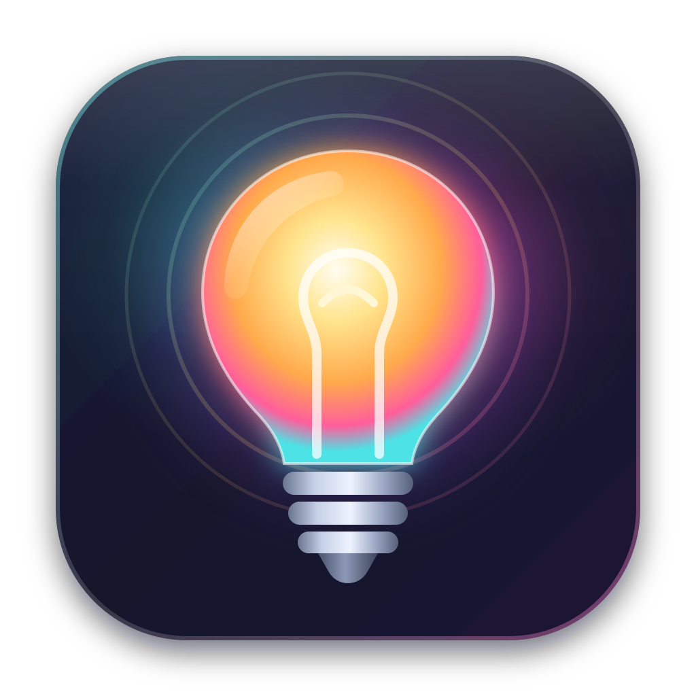

# Maprisma Lights — Mac App Store Launch Kit (Free + One-Time Pro Unlock)

*(Vector SVG source: [app_icon_1024.svg](AppIcon.svg) — exported into [AppIcon.appiconset](Assets.xcassets/AppIcon.appiconset/) for Xcode & `build-mac.sh`.)*

---

## 1. App Store Connect Metadata (Ready to Paste)

- **App Name:** **`Maprisma Lights`** *(15 chars — clean, DPMA/EUIPO & App Store clear, no "Hue" in brand title)*
- **Bundle ID:** **`com.maprisma.lights`**
- **Primary Category:** Utilities · **Secondary Category:** Lifestyle
- **Pricing Model (Option A — Zero Subscription):**
  - **Base App Download:** **Free**
  - **Non-Consumable IAP Product ID:** **`com.maprisma.lights.pro`** (`Maprisma Lights Pro`, Family Sharing enabled)
  - **Price Tier:** **$7.99 / €7.99** launch offer → **$9.99 / €9.99** standard one-time purchase *(NO subscription)*
- **Age Rating:** 4+ (no objectionable content)
- **App Privacy Nutrition Label:** **Data Not Collected** (all smart-lighting traffic stays on the local LAN across Philips Hue, Home Assistant, WLED, WiZ, LIFX, Govee LAN, Nanoleaf, Shelly, and IKEA DIRIGERA; credentials stay in macOS Keychain; optional Ask AI runs strictly locally/loopback-only; audio for the Light Synthesizer is analyzed strictly in memory and never recorded or transmitted).
- **Export Compliance (`ITSAppUsesNonExemptEncryption`):** `NO` (uses only standard Apple OS TLS/HTTPS on the local network).

### Free vs. Demo vs. Pro Feature Matrix

| Feature | Free (Real Devices) | Demo Mode (Simulated Home) | Pro (One-Time IAP `com.maprisma.lights.pro`) |
| :--- | :---: | :---: | :---: |
| Native resizable window & menu bar quick-toggle | ✅ Free | ✅ Unlocked | ✅ Unlocked |
| Multi-brand local control (works with Philips Hue, Home Assistant, WLED, WiZ, LIFX, Govee LAN, Nanoleaf, Shelly & IKEA DIRIGERA) | ✅ Free | ✅ Unlocked | ✅ Unlocked |
| Rooms, Zones, Lights (power, brightness, color/warmth, scenes, rename, favorites) | ✅ Free | ✅ Unlocked | ✅ Unlocked |
| Bridge & LAN discovery, pairing & pinned HTTPS | ✅ Free | ✅ Unlocked | ✅ Unlocked |
| Animated Help & Guide (`?`), Native skin, 8 languages, Local MCP server (`--mcp`) | ✅ Free | ✅ Unlocked | ✅ Unlocked |
| Schedules (Bridge & Mac) | ✅ Free | ✅ Unlocked | ✅ Unlocked |
| Visual Floorplan Studio v2 (polygons, multi-floor, gallery, future lighting planner & 12 lamp icons) | 🔒 Preview in Demo | ✅ Unlocked | ✅ Unlocked |
| Visual Rules & physical sensors (`Rules` tab) | 🔒 Preview in Demo | ✅ Unlocked | ✅ Unlocked |
| Hue Bridge Pro MotionAware™ controls | 🔒 Preview in Demo | ✅ Unlocked | ✅ Unlocked |
| Audio Reactive Light Synth (`Synth` tab) | 🔒 Preview in Demo | ✅ Unlocked | ✅ Unlocked |
| All 6 custom Skins (5 custom + Native) | Native free / 5 🔒 | ✅ Unlocked | ✅ Unlocked |
| Optional local-first Ask AI (default OFF, loopback-only) | 🔒 Preview in Demo | ✅ Unlocked | ✅ Unlocked |

### Local StoreKit 2 Testing in Xcode
1. Open the generated Xcode project (`MacAppStore/project.yml` → `xcodegen generate`).
2. Add `MacAppStore/MaprismaHueLights.storekit` to the project (if not already referenced).
3. Go to **Product → Scheme → Edit Scheme… → Run → Options → StoreKit Configuration** and select **`MaprismaHueLights.storekit`**.
4. Run the app in Debug mode to test real StoreKit 2 **Purchase**, **Restore Purchases**, **Transaction.updates**, and **Revocation** locally without an App Store Connect sandbox account.
5. In Debug builds, **Settings → Pro / License → Debug License Simulation** also lets you switch instantly between **StoreKit Live**, **Simulate Free**, and **Simulate Pro** (stripped out completely in Release builds).

### English (`en-US` / `en-GB`)
- **Name (30 chars max):** `Maprisma Lights` *(15 chars)*
- **Subtitle (30 chars max):** `Smart Lights, Floorplan & Sync` *(30 chars)*
- **Promotional Text (170 chars max):**
  > Native macOS local lighting controller — works with Philips Hue, Home Assistant, WLED, WiZ, LIFX, Govee, Nanoleaf, Shelly & IKEA DIRIGERA. Floorplan Studio v2 & Music Sync.
- **Keywords (100 chars max):**
  `smart lights,floorplan,smart home,menu bar,music sync,led,bulbs,dimmer,automation,scenes,lamps,local`
- **Description:**
  > **Take full control of your smart lights straight from your Mac menu bar — fast, native, 100% local, and with zero subscription.**
  >
  > Maprisma Lights is built natively in Swift for macOS and works with **Philips Hue** alongside **Home Assistant, WLED, WiZ, LIFX, Govee LAN, Nanoleaf, Shelly, and IKEA DIRIGERA** — all directly on your local network with no cloud accounts and no monthly fees.
  >
  > **NEW: Floorplan Studio v2 & Future Lighting Planner**
  > - Place lights freely on a live 2D home canvas — start from realistic apartment & house drawings in the **Floorplan Gallery** (*Altbau 3-Room Apartment, 2-Story Family House, L-Shaped Bungalow, Open-Plan Loft*, and more) or import your own **custom floorplan image**.
  > - Reshape rooms into **L-shapes, bay windows, T-shapes, and angled walls** with draggable vertices, wall lengths in meters, `m²` area, **multi-floor tabs (Ground / Upper)**, and rotatable furniture stamps including stairs.
  > - **Plan Future Lighting:** Place virtual fixtures and bendable LED lightstrips, preview Day/Dusk/Night illumination and room Lux coverage, review your shopping list, and bind planned fixtures to real lights in 1 click.
  > - Draw **visual dependency wires** directly between lights & sensors (Follow/Mirror, Exclusive, Companion) and push Hue rooms, zones, names, and **Entertainment Area 2D/3D positions** to your Philips Hue Bridge with **1-click Sync All** or **Auto-sync**.
  >
  > **Instant Menu Bar + Resizable Window**
  > - Toggle rooms, zones, and individual lights across all 9 local ecosystems in one click — or pop out a full 2-column window.
  > - Master **All On / All Off** with per-room exclusions and optional confirmation.
  > - Pin favorite lights, rooms, and scenes to the top strip, and filter by On, Rooms, Zones, or Favorites.
  >
  > **Per-Lamp Light Themes, Colors & Effects**
  > - Dial in Kelvin warmth, full color, or native device effects, and save custom **Light Themes** per lamp or pick from 8 built-in themes.
  >
  > **Schedules, Visual Rules, Sensors & MotionAware™**
  > - Schedule lights or rooms by clock time or **Sunrise / Sunset** (± offset) on your Hue Bridge or live on your Mac.
  > - Link lights, rooms, physical sensors/switches, and **Bridge Pro MotionAware™** presence areas in real time, plus Mac wake/sleep/lock triggers.
  >
  > **Animated Help Guide, Optional Ask AI (Off by Default) & Free Local MCP Server**
  > - **Ask AI is strictly optional and OFF by default:** zero AI buttons appear unless you enable it in Settings (`⌘K`, offline + loopback-only local Ollama).
  > - **Local MCP Server (`--mcp`):** Included free for power users connecting local MCP agents over stdio — credentials stay in macOS Keychain.
  >
  > **Live Audio Light Synthesizer & Personalization**
  > - Sync lights to **system music** or **microphone** with 3-band FFT & beat detection, **6 App Skins**, **8 Menu Bar Icons**, **Global Keyboard Shortcuts**, **Apple Shortcuts & Siri**, **8 languages**, and a full **Interactive Demo Home**.
  >
  > *One-time Pro unlock. Zero subscriptions. Zero cloud. Zero tracking.*
  > *Independent third-party app. Not affiliated with or endorsed by Signify Holding (Philips Hue), IKEA, LIFX, Govee, Nanoleaf, Shelly, WiZ, WLED, or Home Assistant.*

### German (`de-DE`) — Top European Smart-Lighting Market
- **Name:** `Maprisma Lights`
- **Subtitle (30 chars max):** `Licht, Grundriss & Musik-Sync` *(29 chars)*
- **Promotional Text:**
  > Native macOS-Lichtsteuerung für Philips Hue, Home Assistant, WLED, WiZ, LIFX, Govee, Nanoleaf, Shelly & IKEA DIRIGERA. Grundriss-Studio v2, Lichtplaner & Musik-Sync. Kein Abo.
- **Keywords (100 chars max):**
  `smart light,grundriss,smart home,menüleiste,musik sync,licht,lampen,dimmer,szenen,automation,lokal`
- **Description (summary highlights ready for App Store Connect):**
  > Steuere deine smarten Lampen direkt aus der macOS-Menüleiste — blitzschnell, nativ in Swift, 100 % lokal und ohne Abo. Kompatibel mit **Philips Hue, Home Assistant, WLED, WiZ, LIFX, Govee LAN, Nanoleaf, Shelly und IKEA DIRIGERA**.
  > - **Grundriss-Studio v2 & Zukunfts-Lichtplaner (Map-Tab):** Formbare Polygon-Räume (L-Form, Erker, T-Form, schräge Wände), mehrere Etagen, realistische Grundriss-Galerie (Altbau, Einfamilienhaus, Bungalow, Loft), Tag/Dämmerung/Nacht-Vorschau, Lux/m²-Berechnung, Einkaufsliste und 1-Klick-Verknüpfung mit echten Lampen.
  > - **Menüleiste + eigenes Fenster:** Räume, Zonen, Einzellampen, Favoriten, Filter sowie „Alle an / Alle aus" mit Raum-Ausnahmen.
  > - **Lichtthemen-Editor, Zeitpläne & Abhängigkeits-Regeln:** Farbtemperatur, Farben, Effekte, Zeitpläne (Bridge oder Mac), physische Sensoren, Bridge Pro MotionAware™ und Mac-Aufwachen/Ruhezustand/Sperren.
  > - **Animierte Hilfe, optionales „Ask AI" (standardmäßig AUS, nur lokal/Loopback) & kostenloser lokaler MCP-Server (`--mcp`).**
  > - **Musik-Licht-Synthesizer & 6 App-Skins:** Systemmusik/Mikrofon-Sync, 8 Menüleisten-Icons, globale Tastenkürzel, Apple Kurzbefehle & Siri, 8 Sprachen und Demo-Modus.
  > - *Unabhängige Drittanbieter-App. Keine Verbindung zu oder Unterstützung durch Signify Holding (Philips Hue), IKEA, LIFX, Govee, Nanoleaf, Shelly, WiZ, WLED oder Home Assistant.*

### Compact Localized Subtitles & Keywords (FR / ES / IT / PT / NL / PL)
| Locale | Subtitle (≤30 chars) | Keywords (≤100 chars) |
| :--- | :--- | :--- |
| **fr-FR** | `Lumières, Plan & Sync Musique` | `lumières,plan,domotique,barre menus,musique,ampoules,lampes,scènes,automatisation,led,local` |
| **es-ES** | `Luces, Planos y Sync Musical` | `luces,planos,domótica,barra menús,música,bombillas,lámparas,escenas,automatización,led,local` |
| **it-IT** | `Luci, Planimetria & Musica` | `luci,planimetria,domotica,barra menu,musica,lampadine,lampade,scene,automazione,led,locale` |
| **pt-BR / pt-PT** | `Luzes, Planta & Sync Musical` | `luzes,planta,casa inteligente,barra menu,música,lâmpadas,cenas,automação,led,local` |
| **nl-NL** | `Licht, Plattegrond & Muziek` | `verlichting,plattegrond,smart home,menubalk,muziek,lampen,dimmer,scènes,automatisering,led,lokaal` |
| **pl-PL** | `Światła, Plan i Sync Muzyki` | `światła,plan,smart home,pasek menu,muzyka,żarówki,lampy,sceny,automatyzacja,led,lokalnie` |

---

## 2. App Review Notes (Paste into App Store Connect → App Review Information)

> **Important — Testing Without Hardware (Built-in Interactive Demo Mode):**
> Maprisma Lights opens directly into its main resizable macOS window on launch (`LSUIElement = false`) and also provides a lightbulb icon in the top-right macOS menu bar for quick show/hide (left-click) and quick controls (right-click).
> On the initial setup screen, click **"Try Demo Home"** (top-right button or preview card) to launch a complete simulated multi-room smart home (4 rooms, 9 color/white lights, scenes, Floorplan Studio v2 with polygons, multi-floor tabs, gallery templates and Future Lighting Planner, schedules, live dependency rules, Light Theme Editor, and the Audio Light Synthesizer with a built-in **"Demo Beat"** source) entirely in memory — no physical smart-lighting hardware is required for review.
>
> **Testing the One-Time Pro In-App Purchase (`com.maprisma.lights.pro`) & Restore Purchases:**
> In Demo Mode, all Pro features are unlocked for risk-free evaluation. To test the Pro paywall, Purchase, and Restore Purchases flow: click the **"Demo"** badge in the header → **"Connect Bridge"** (or open **Settings → Pro / License → Unlock Pro…**). You can test Purchase and Restore Purchases via StoreKit Sandbox.
>
> **Supported Local-Network Hardware, Capabilities & Entitlements Explained:**
> Maprisma Lights communicates strictly on the user's local network with Philips Hue Bridges and 8 additional local-first smart lighting ecosystems (**Home Assistant, WLED, WiZ, LIFX, Govee LAN, Nanoleaf, Shelly, and IKEA DIRIGERA**). All device tokens and app keys are stored locally in the macOS Keychain.
> - **Local Network & Bonjour (`com.apple.security.network.client`, `NSAllowsLocalNetworking`):** Discovers (`_hue._tcp`, `_home-assistant._tcp`, `_wled._tcp`, `_nanoleafapi._tcp`, `_shelly._tcp`, `_ihsp._tcp`) and controls local lighting devices over HTTPS/HTTP/UDP on the user's LAN.
> - **Incoming Local UDP (`com.apple.security.network.server`):** Required specifically to receive local LAN status replies from **Govee LAN** smart lights, whose protocol sends unicast UDP responses back to the app on **UDP port 4002**. No internet-facing server is exposed.
> - **User-Selected Read-Only Files (`com.apple.security.files.user-selected.read-only`):** Used only when the user clicks "Choose Image…" in Floorplan Studio (`NSOpenPanel`) to import a custom floorplan background image, which is copied into the app's sandbox container.
> - **Screen & System Audio Recording (`ScreenCaptureKit`):** Used exclusively for audio-only capture (`capturesAudio = true`) when the user explicitly starts the **Light Synthesizer** with "System Audio" selected. No screen video or audio is ever recorded, saved, or sent off-device.
> - **Microphone (`com.apple.security.device.audio-input` / `AVAudioEngine`):** Optional alternative input for the Light Synthesizer when the user selects "Microphone". Audio is analyzed in memory only.
> - **Launch at Login (`SMAppService.mainApp`) & Global Shortcuts (Carbon `RegisterEventHotKey`):** Both are sandbox-safe, off by default, and require zero Accessibility permissions. When launched at login, the app starts quietly in the menu bar without popping open a window.
> - **Optional Ask AI (OFF by default) & Local `--mcp` Stdio Server:** When manually enabled by the user, Ask AI runs strictly offline on-device with optional loopback-only (`127.0.0.1` / `localhost`) local Ollama support. Power users may optionally invoke the app binary with `--mcp` over stdio for local agent automation (sandboxed, local-only, never exposes credentials).
> - **No account, no cloud, no analytics, no tracking.**

---

## 3. Privacy Policy Text (Host at `https://maprisma.com/lights-privacy.html`)

> **Maprisma Lights — Privacy Policy**
> Maprisma Lights does not collect, store, share, or sell any personal data.
> - **Local Network Only:** The app communicates exclusively on your local network with your configured smart lighting devices (Philips Hue Bridge, Home Assistant, WLED, WiZ, LIFX, Govee LAN, Nanoleaf, Shelly, and IKEA DIRIGERA). All bridge keys and device access tokens are stored locally in your macOS Keychain and never leave your Mac except to authenticate directly with the corresponding local device.
> - **Optional Ask AI (Off by Default):** If you opt in to Ask AI in Settings, natural-language commands are parsed locally on your Mac; optional Ollama integration connects strictly to loopback (`127.0.0.1` / `localhost`) and never sends data to external cloud APIs.
> - **Floorplan Images:** Custom floorplan background images selected via the macOS file picker are copied locally inside the app's sandbox container and never uploaded.
> - **Audio Analysis:** When you start the Light Synthesizer with System Audio or Microphone input, audio samples are analyzed strictly in memory on your Mac to compute light brightness and color. Audio is never recorded, written to disk, or transmitted over the network.
> - **No Analytics or Tracking:** There are no third-party SDKs, ads, telemetry, or cloud servers.
> - **Contact:** Uwe Bruckhaus — `support@maprisma.com` (or your preferred contact email).

---

## 4. App Store Screenshot Shot List (Take 6 Raw Shots on Your Mac in Demo Mode)

Apple Mac App Store accepts **16:10** images at **`2880×1800`** (best) or **`2560×1600`** / **`1440×900`** / **`1280×800`**.

Take these 7 clean screenshots on your Mac in **Demo Mode** (so zero private room names appear), and send them here — I will frame & composite them into localized marketing slides:
1. **Hero Shot #1 — Visual Floorplan Studio (`Map` tab, detached wide window):** 3-Room Apartment prototype glowing with live lamp halos, custom SF Symbol lamp icons, furniture stamps, typed Bezier dependency wires, `⏰` badges on Living Room & Office, and the 1-click **Sync All** toolbar. → Headline: *"Map Your Home. Wire Your Lights. Sync in 1 Click."*
2. **Hero Shot #2 (`Lights` tab, wide 2-column window):** Office & Living Room glowing in rich warm/neon colors, Favorites strip visible, `All On / All Off` footer, menu bar icon visible. → Headline: *"Every Smart Light, One Click Away"*
3. **Per-Lamp Light Theme Editor & Color Popover:** Open on a Living Room light showing the Color/Kelvin wheel, Hue Effects, and custom Light Themes. → Headline: *"Custom Themes & Native Effects per Lamp"*
4. **Audio Light Synthesizer (`Synth` tab, Demo Beat active):** Live Bass/Mids/Treble spectrum pulsing, Color Wave / Neon palette selected. → Headline: *"Sync Your Lights to Music — No Extra App"*
5. **Dependency & Linked-Light Rules (`Rules` tab):** Showing `"When Office Desk turns ON → Monitor Backlight ON"` + `"When Mac wakes → Office ON"`. → Headline: *"Smart Rules & Mac Wake/Sleep Triggers"*
6. **Per-Light & Room Scene Schedules (`Schedules` tab):** Showing Sunrise/Sunset + Room Scene schedules with `"Bridge"` / `"Mac"` badges. → Headline: *"Schedules That Run Right on Your Bridge"*
7. **Fun Skins & Customization (`Settings` / side-by-side Skins):** Showing *Neon Synthwave*, *Cozy Cabin*, and *Retro Terminal* skins + selectable Menu Bar Icons. → Headline: *"6 Skins, 8 Menu Bar Icons, 8 Languages"*

---

## 5. Step-by-Step Submission Checklist (With Your Apple Developer Membership)

1. **Apply for Apple Small Business Program** *(if not enrolled yet — takes 5 min at `developer.apple.com/app-store/small-business-program/`)*: cuts Apple's fee from 30% → **15%**.
2. **Choose your permanent Bundle ID** in Apple Developer Portal → *Certificates, Identifiers & Profiles* (`com.maprisma.lights`).
3. **Create the app record** in **App Store Connect** → *My Apps → New App (macOS)*, set Base App to **Free** + Non-Consumable IAP `com.maprisma.lights.pro` (**$7.99 / €7.99** launch → **$9.99 / €9.99** standard), paste metadata, upload App Icon & 2880×1800 screenshots, add Privacy Policy URL & App Review Notes.
4. **Archive & Upload from Xcode on your Mac:**
   - Open the Xcode project (we'll generate an XcodeGen `project.yml` / `.xcodeproj` with `MaprismaHueLights.entitlements`, `PrivacyInfo.xcprivacy`, and `AppIcon.appiconset`).
   - Select **Any Mac (Apple Silicon, Intel)** → **Product → Archive** → **Distribute App → App Store Connect → Upload**.
5. **Pre-Launch Commercial Switch (right before clicking "Release"):**
   - Make `maprisma/macos-hue-lights` **private** on GitHub and delete the public `v0.2.0` release.
   - Remove the free macOS Hue Lights GitHub download from `maprisma.com` and add the **Mac App Store** badge/link once approved.
   - Ensure `NSHumanReadableCopyright` in `Info.plist` is `© 2026 Uwe Bruckhaus. All rights reserved.` (no MIT `LICENSE` bundled in the paid MAS app).

---

## 6. Marketing & Launch Playbook

### Best-ROI Channels (in order)
1. **Hueblog.de & Hueblog.com (Highest conversion for Hue apps!):**
   - Email Fabian (`info@hueblog.de`) with a short personal note (in German!), 3 screenshots, a 15-second screen recording of the Music Synthesizer + linked desk lights, and **2–3 free App Store promo codes** (App Store Connect gives you 100 free promo codes per version!). Hueblog readers are hardcore Philips Hue owners who happily pay €9.99 one-time for a clean, no-subscription Mac app.
2. **Reddit (`r/Hue`, `r/macapps`, `r/MacOS`, `r/shortcuts`):**
   - Lead with the story & craft, not a hard ad: *"I built a native SwiftUI Philips Hue menu bar app for macOS because I wanted per-light schedules, linked desk lights, Mac wake/sleep triggers, and music sync in one lightweight app — no Electron, no cloud, no subscription."*
   - Include a crisp 15-second GIF/video showing: clicking menu bar bulb → toggling Desk Lamp (Monitor Backlight follows automatically!) → starting Music Synth → flipping from System to Neon Synthwave skin.
   - Give away 5–10 promo codes in the comments on `r/macapps` (drives massive engagement and early 5-star reviews!).
3. **Product Hunt & Hacker News (`Show HN`):**
   - Angle for HN: *"Built a 100% pure-Swift, sandboxed Mac menu bar controller for Philips Hue (CLIP v2 SSE, DTLS-PSK Entertainment streaming, ScreenCaptureKit vDSP FFT music sync, pinned self-signed bridge TLS, zero cloud)."* — technical depth plays super well on HN.
4. **In-App Review Prompt (v1.0.1 / nice touch):**
   - Trigger Apple's native `SKStoreReviewController.requestReview()` once after e.g. 7 days & 15 successful light toggles (never on first launch, never after an error) — this is the #1 driver of App Store ranking over time.
